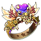
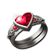
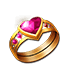
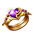
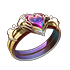
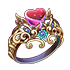
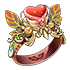

# Wedding ring

Married couples get a wedding ring that gives stats. The ring grows with **Happiness**, which both spouses earn together, so they usually have nearly the same Happiness and the same ring level (each player has their own total; in-game the two can differ by a few hundred). The ring goes from level 1 to **20**.

## Getting married

- Marriage opens at **level 16**. Propose to an online friend of the opposite sex on your server.
- After they accept, book a wedding. The wedding type sets the Happiness you start with, and so your first ring level.
- Divorce costs ** 500** Diamonds, and the wedding ring disappears. You cannot divorce between booking the wedding and its end.

| Wedding | Price (Diamonds) | Happiness | Ring level it reaches |
|---|---|---|---|
|  Common |  999 | 999 | Lv 1 |
|  Deluxe |  1,799 | 1,999 | Lv 2 |
|  Royal Wedding |  2,699 | 3,899 | Lv 3 |

## Gaining Happiness

- **Fight together**: spouses who team up get 5% more EXP, and every battle they fight together adds Happiness (the game doesn't show how much).
- **Wedding gifts**: during the wedding, guests send gifts that add Happiness. Only the couple can send Candy.
- **Items**: use them from the bag while you have a wedding ring.

| Gift | Price (Diamonds) | Happiness |
|---|---|---|
| Flower |  100 | +120 |
| Balloon |  300 | +390 |
| Firework |  500 | +700 |
| Candy |  800 | +1,600 |

| Item | Happiness | Where to get |
|---|---|---|
|  Love Letter | +1,200 | Event |
|  Ocean Heart | +3,000 | Event |
|  Dreamy Carriage | +7,200 | Event |

## Ring levels

- **Happiness total** = the couple's total Happiness needed for that level; **From the level before** = how much more that is than the level before.
- The stats are the ring's stats at that level (the total, not added on top of the level before). **BP** = ATK × 3.3 + DEF × 3.3 + HP × 0.5 + (DMG+ + DMG-) × 3, rounded up.

| Level | Ring | Quality | Happiness total | From the level before | ATK | DEF | HP | DMG+ | DMG- | BP |
|---|---|---|---|---|---|---|---|---|---|---|
| 1 |  Wedding Ring Lv1 | White | 999 | 999 | 4 | 3 | 15 | 1 | 1 | **37** |
| 2 |  Wedding Ring Lv2 | Green | 1,999 | 1,000 | 8 | 6 | 30 | 2 | 2 | **74** |
| 3 |  Wedding Ring Lv2 | Green | 3,898 | 1,899 | 32 | 24 | 120 | 8 | 8 | **293** |
| 4 |  Wedding Ring Lv3 | Blue | 7,997 | 4,099 | 64 | 48 | 240 | 16 | 16 | **586** |
| 5 |  Wedding Ring Lv3 | Blue | 14,996 | 6,999 | 120 | 90 | 450 | 30 | 30 | **1,098** |
| 6 |  Wedding Ring Lv4 | Blue | 30,995 | 15,999 | 196 | 147 | 735 | 49 | 49 | **1,794** |
| 7 |  Wedding Ring Lv4 | Purple | 59,994 | 28,999 | 272 | 204 | 1,020 | 68 | 68 | **2,489** |
| 8 |  Wedding Ring Lv5 | Purple | 101,993 | 41,999 | 376 | 282 | 1,410 | 94 | 94 | **3,441** |
| 9 |  Wedding Ring Lv5 | Orange | 154,992 | 52,999 | 472 | 354 | 1,770 | 118 | 118 | **4,319** |
| 10 |  Wedding Ring Lv6 | Orange | 221,991 | 66,999 | 584 | 438 | 2,190 | 146 | 146 | **5,344** |
| 11 |  Oath Ring | Orange | 321,990 | 99,999 | 758 | 569 | 2,844 | 190 | 212 | **7,008** |
| 12 |  Oath Ring | Orange | 451,989 | 129,999 | 965 | 724 | 3,619 | 241 | 269 | **8,914** |
| 13 |  Immortal Ring | Orange | 641,988 | 189,999 | 1,223 | 917 | 4,586 | 306 | 342 | **11,299** |
| 14 |  Immortal Ring | Orange | 901,987 | 259,999 | 1,493 | 1,120 | 5,598 | 373 | 417 | **13,792** |
| 15 |  Eternal Ring | Red | 1,261,986 | 359,999 | 1,762 | 1,321 | 6,607 | 441 | 492 | **16,277** |
| 16 |  Eternal Ring | Red | 1,486,985 | 224,999 | 1,861 | 1,396 | 7,183 | 500 | 558 | **17,514** |
| 17 |  Eternal Ring | Red | 1,755,984 | 268,999 | 2,062 | 1,547 | 8,007 | 564 | 629 | **19,493** |
| 18 |  Eternal Ring | Red | 2,024,983 | 268,999 | 2,264 | 1,699 | 8,831 | 627 | 700 | **21,475** |
| 19 |  Eternal Ring | Red | 2,293,982 | 268,999 | 2,465 | 1,849 | 9,654 | 691 | 771 | **23,450** |
| 20 |  Eternal Ring | Red | 2,562,981 | 268,999 | 2,667 | 2,000 | 10,478 | 754 | 842 | **25,429** |

From the first ring to Lv 20 takes 2,561,982 Happiness: for example 1,602 Candy gifts, or 356 Dreamy Carriage.
