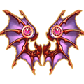
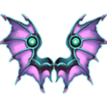
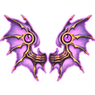
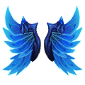
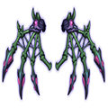
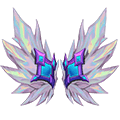

# Wings

Wings are a costume slot with their own stats, a battle trait and a **Bonus**. Copies of a wing level it up (Blue → Purple → Orange). The **Wing Heart** (the **Foster** button on the Wing screen) has 5 slots that you level from 1 to 100 with Down Plume, Flame Plume, Aurora Plume; a wing put in a slot adds its Bonus % of that slot's stats.

- [Rules](#rules) · [Wing Heart levels 1 - 100](#heart-levels) · [Heart Trait](#heart-trait) · [Plumes](#plumes) · [All wings](#all-wings)

## Rules

- The Wing screen opens at **level 8** (Role screen, Wing tab). It lists the wings you own; wings sitting in a Heart slot come first, marked **Equipped**.
- **Wearing a wing:** tap it. That puts it in the Main Wing slot (**Wing Soul**), which is the wing your character shows. The eye button hides or shows wings on your character.
- **Leveling a wing:** every wing has a bar that fills with copies of the same wing. When it is full the wing gets a red dot; tap it to level it up. Most wings go Blue → Blue +1 → Blue +2 → Purple → Purple +1 → Purple +2 → Orange (Sharijah's Wings: Blue → Purple → Orange). Each step raises the wing's stats and Bonus and can upgrade its trait; the copies each step needs are in the wing tables below. Game help text: "After Wings reach Orange rank, extra Wings will be converted into Feathers."
- **Wing Heart slots:** **Wing Soul** (Main Wing, from the start),  **Plume Light** (Sub Wing, Main Wing slot Lv 10),  **Wind Scar** (Sub Wing, Main Wing slot Lv 20),  **Skybound** (Sub Wing, Main Wing slot Lv 50),  **Feather Blade** (Sub Wing, Main Wing slot Lv 70). The Sub Wing slots stay **Locked** until the Main Wing slot reaches their level.
- Each slot has its own level, from **1** up to **100**. One press of **Upgrade** raises the slot by 1 level and uses that level's cost (plumes only; no Coins or Diamonds). The slot gives its stats on its own; the cost and stats per level are in [the level table](#heart-levels).
- **Putting a wing in a slot:** in Heart Details press **replace**, pick a wing and press **Assemble** (or **Remove**). One wing per slot, a wing can only sit in one slot, and the Main Wing can't be removed ("Main wing cannot be unequipped"). The wing adds **its Bonus %** of each of the slot's stats, rounded up: added = ⌈slot stat × Bonus⌉. Example: Deathwing at Orange has Bonus 600%, so in the Wing Soul slot at Lv 100 (ATK 6,061) it adds ATK +36,366.
- **Heart Trait:** the levels of the unlocked Sub Wing slots add up; at each total in [the trait table](#heart-trait) the trait gets stronger.
- **Conjure** (change look): unlocks when the Main Wing slot reaches **Lv 30** ("Unlocks when Main Wing reaches Lv.30"). Pick a wing (the Main Wing by default) and another wing you own whose look it takes; each change costs  Diamond ×100. Game text: "Conjure changes only appearance, not stats or traits". The look is that of the other wing at its current level; picking the wing itself turns the look back. The look can also be shown or hidden.
- **Collection:** the Wing page of the collection book has an entry for each wing at some of its steps (marked in the **Book stars** column of the wing tables); each entry adds its stars, 135 stars for all wings.

## Wing Heart levels 1 - 100

Cost to max, from Lv 1 to Lv 100:

| Slots | Unlocks |  Down Plume |  Flame Plume |  Aurora Plume |
|---|---|---|---|---|
| Wing Soul | from the start | 9,990 | 3,996 | 400 |
|  Plume Light | Main Wing slot Lv 10 | 4,995 | 1,998 | 190 |
|  Wind Scar | Main Wing slot Lv 20 | 4,995 | 1,998 | 190 |
|  Skybound | Main Wing slot Lv 50 | 4,995 | 1,998 | 190 |
|  Feather Blade | Main Wing slot Lv 70 | 4,995 | 1,998 | 190 |
| **All 4 Sub Wing slots** | | 19,980 | 7,992 | 760 |
| **Whole Wing Heart** | | 29,970 | 11,988 | 1,160 |

### Wing Soul

Stats are the slot's own stats at that level (before a wing's Bonus). **Next** is what one press of Upgrade uses at that level; **Spent** is everything used from Lv 1 to reach that level.

| Lv | ATK | DEF | HP | CRIT | DMG+ | Burst DMG+ | Next:  Down Plume | Next:  Flame Plume | Next:  Aurora Plume | Spent:  Down Plume | Spent:  Flame Plume | Spent:  Aurora Plume |
|---|---|---|---|---|---|---|---|---|---|---|---|---|
| 1 | 61 | 61 | 600 | 50 | 34 | 34 | 10 | 4 | - | - | - | - |
| 2 | 122 | 122 | 1,200 | 100 | 67 | 67 | 10 | 4 | - | 10 | 4 | - |
| 3 | 182 | 182 | 1,800 | 150 | 100 | 100 | 10 | 4 | - | 20 | 8 | - |
| 4 | 243 | 243 | 2,400 | 200 | 134 | 134 | 10 | 4 | - | 30 | 12 | - |
| 5 | 304 | 304 | 3,000 | 250 | 167 | 167 | 10 | 4 | - | 40 | 16 | - |
| 6 | 364 | 364 | 3,600 | 300 | 200 | 200 | 10 | 4 | - | 50 | 20 | - |
| 7 | 425 | 425 | 4,200 | 350 | 234 | 234 | 10 | 4 | - | 60 | 24 | - |
| 8 | 485 | 485 | 4,800 | 400 | 267 | 267 | 10 | 4 | - | 70 | 28 | - |
| 9 | 546 | 546 | 5,400 | 450 | 300 | 300 | 10 | 4 | - | 80 | 32 | - |
| 10 | 607 | 607 | 6,000 | 500 | 334 | 334 | 20 | 8 | 1 | 90 | 36 | - |
| 11 | 667 | 667 | 6,600 | 550 | 367 | 367 | 20 | 8 | 1 | 110 | 44 | 1 |
| 12 | 728 | 728 | 7,200 | 600 | 400 | 400 | 20 | 8 | 1 | 130 | 52 | 2 |
| 13 | 788 | 788 | 7,800 | 650 | 434 | 434 | 20 | 8 | 1 | 150 | 60 | 3 |
| 14 | 849 | 849 | 8,400 | 700 | 467 | 467 | 20 | 8 | 1 | 170 | 68 | 4 |
| 15 | 910 | 910 | 9,000 | 750 | 500 | 500 | 30 | 12 | 1 | 190 | 76 | 5 |
| 16 | 970 | 970 | 9,600 | 800 | 534 | 534 | 30 | 12 | 1 | 220 | 88 | 6 |
| 17 | 1,031 | 1,031 | 10,200 | 850 | 567 | 567 | 30 | 12 | 1 | 250 | 100 | 7 |
| 18 | 1,091 | 1,091 | 10,800 | 900 | 600 | 600 | 30 | 12 | 1 | 280 | 112 | 8 |
| 19 | 1,152 | 1,152 | 11,400 | 950 | 634 | 634 | 30 | 12 | 1 | 310 | 124 | 9 |
| 20 | 1,213 | 1,213 | 12,000 | 1,000 | 667 | 667 | 50 | 20 | 2 | 340 | 136 | 10 |
| 21 | 1,273 | 1,273 | 12,600 | 1,050 | 700 | 700 | 50 | 20 | 2 | 390 | 156 | 12 |
| 22 | 1,334 | 1,334 | 13,200 | 1,100 | 734 | 734 | 50 | 20 | 2 | 440 | 176 | 14 |
| 23 | 1,394 | 1,394 | 13,800 | 1,150 | 767 | 767 | 50 | 20 | 2 | 490 | 196 | 16 |
| 24 | 1,455 | 1,455 | 14,400 | 1,200 | 800 | 800 | 50 | 20 | 2 | 540 | 216 | 18 |
| 25 | 1,516 | 1,516 | 15,000 | 1,250 | 834 | 834 | 50 | 20 | 2 | 590 | 236 | 20 |
| 26 | 1,576 | 1,576 | 15,600 | 1,300 | 867 | 867 | 50 | 20 | 2 | 640 | 256 | 22 |
| 27 | 1,637 | 1,637 | 16,200 | 1,350 | 900 | 900 | 50 | 20 | 2 | 690 | 276 | 24 |
| 28 | 1,697 | 1,697 | 16,800 | 1,400 | 934 | 934 | 50 | 20 | 2 | 740 | 296 | 26 |
| 29 | 1,758 | 1,758 | 17,400 | 1,450 | 967 | 967 | 50 | 20 | 2 | 790 | 316 | 28 |
| 30 | 1,819 | 1,819 | 18,000 | 1,500 | 1,000 | 1,000 | 50 | 20 | 2 | 840 | 336 | 30 |
| 31 | 1,879 | 1,879 | 18,600 | 1,550 | 1,034 | 1,034 | 50 | 20 | 2 | 890 | 356 | 32 |
| 32 | 1,940 | 1,940 | 19,200 | 1,600 | 1,067 | 1,067 | 50 | 20 | 2 | 940 | 376 | 34 |
| 33 | 2,000 | 2,000 | 19,800 | 1,650 | 1,100 | 1,100 | 50 | 20 | 2 | 990 | 396 | 36 |
| 34 | 2,061 | 2,061 | 20,400 | 1,700 | 1,134 | 1,134 | 50 | 20 | 2 | 1,040 | 416 | 38 |
| 35 | 2,122 | 2,122 | 21,000 | 1,750 | 1,167 | 1,167 | 50 | 20 | 2 | 1,090 | 436 | 40 |
| 36 | 2,182 | 2,182 | 21,600 | 1,800 | 1,200 | 1,200 | 50 | 20 | 2 | 1,140 | 456 | 42 |
| 37 | 2,243 | 2,243 | 22,200 | 1,850 | 1,234 | 1,234 | 50 | 20 | 2 | 1,190 | 476 | 44 |
| 38 | 2,304 | 2,304 | 22,800 | 1,900 | 1,267 | 1,267 | 50 | 20 | 2 | 1,240 | 496 | 46 |
| 39 | 2,364 | 2,364 | 23,400 | 1,950 | 1,300 | 1,300 | 50 | 20 | 2 | 1,290 | 516 | 48 |
| 40 | 2,425 | 2,425 | 24,000 | 2,000 | 1,334 | 1,334 | 100 | 40 | 4 | 1,340 | 536 | 50 |
| 41 | 2,485 | 2,485 | 24,600 | 2,050 | 1,367 | 1,367 | 100 | 40 | 4 | 1,440 | 576 | 54 |
| 42 | 2,546 | 2,546 | 25,200 | 2,100 | 1,400 | 1,400 | 100 | 40 | 4 | 1,540 | 616 | 58 |
| 43 | 2,607 | 2,607 | 25,800 | 2,150 | 1,434 | 1,434 | 100 | 40 | 4 | 1,640 | 656 | 62 |
| 44 | 2,667 | 2,667 | 26,400 | 2,200 | 1,467 | 1,467 | 100 | 40 | 4 | 1,740 | 696 | 66 |
| 45 | 2,728 | 2,728 | 27,000 | 2,250 | 1,500 | 1,500 | 100 | 40 | 4 | 1,840 | 736 | 70 |
| 46 | 2,788 | 2,788 | 27,600 | 2,300 | 1,534 | 1,534 | 100 | 40 | 4 | 1,940 | 776 | 74 |
| 47 | 2,849 | 2,849 | 28,200 | 2,350 | 1,567 | 1,567 | 100 | 40 | 4 | 2,040 | 816 | 78 |
| 48 | 2,910 | 2,910 | 28,800 | 2,400 | 1,600 | 1,600 | 100 | 40 | 4 | 2,140 | 856 | 82 |
| 49 | 2,970 | 2,970 | 29,400 | 2,450 | 1,634 | 1,634 | 100 | 40 | 4 | 2,240 | 896 | 86 |
| 50 | 3,031 | 3,031 | 30,000 | 2,500 | 1,667 | 1,667 | 120 | 48 | 5 | 2,340 | 936 | 90 |
| 51 | 3,091 | 3,091 | 30,600 | 2,550 | 1,700 | 1,700 | 120 | 48 | 5 | 2,460 | 984 | 95 |
| 52 | 3,152 | 3,152 | 31,200 | 2,600 | 1,734 | 1,734 | 120 | 48 | 5 | 2,580 | 1,032 | 100 |
| 53 | 3,213 | 3,213 | 31,800 | 2,650 | 1,767 | 1,767 | 120 | 48 | 5 | 2,700 | 1,080 | 105 |
| 54 | 3,273 | 3,273 | 32,400 | 2,700 | 1,800 | 1,800 | 120 | 48 | 5 | 2,820 | 1,128 | 110 |
| 55 | 3,334 | 3,334 | 33,000 | 2,750 | 1,834 | 1,834 | 120 | 48 | 5 | 2,940 | 1,176 | 115 |
| 56 | 3,394 | 3,394 | 33,600 | 2,800 | 1,867 | 1,867 | 120 | 48 | 5 | 3,060 | 1,224 | 120 |
| 57 | 3,455 | 3,455 | 34,200 | 2,850 | 1,900 | 1,900 | 120 | 48 | 5 | 3,180 | 1,272 | 125 |
| 58 | 3,516 | 3,516 | 34,800 | 2,900 | 1,934 | 1,934 | 120 | 48 | 5 | 3,300 | 1,320 | 130 |
| 59 | 3,576 | 3,576 | 35,400 | 2,950 | 1,967 | 1,967 | 120 | 48 | 5 | 3,420 | 1,368 | 135 |
| 60 | 3,637 | 3,637 | 36,000 | 3,000 | 2,000 | 2,000 | 120 | 48 | 5 | 3,540 | 1,416 | 140 |
| 61 | 3,697 | 3,697 | 36,600 | 3,050 | 2,034 | 2,034 | 120 | 48 | 5 | 3,660 | 1,464 | 145 |
| 62 | 3,758 | 3,758 | 37,200 | 3,100 | 2,067 | 2,067 | 120 | 48 | 5 | 3,780 | 1,512 | 150 |
| 63 | 3,819 | 3,819 | 37,800 | 3,150 | 2,100 | 2,100 | 120 | 48 | 5 | 3,900 | 1,560 | 155 |
| 64 | 3,879 | 3,879 | 38,400 | 3,200 | 2,134 | 2,134 | 120 | 48 | 5 | 4,020 | 1,608 | 160 |
| 65 | 3,940 | 3,940 | 39,000 | 3,250 | 2,167 | 2,167 | 120 | 48 | 5 | 4,140 | 1,656 | 165 |
| 66 | 4,000 | 4,000 | 39,600 | 3,300 | 2,200 | 2,200 | 120 | 48 | 5 | 4,260 | 1,704 | 170 |
| 67 | 4,061 | 4,061 | 40,200 | 3,350 | 2,234 | 2,234 | 120 | 48 | 5 | 4,380 | 1,752 | 175 |
| 68 | 4,122 | 4,122 | 40,800 | 3,400 | 2,267 | 2,267 | 120 | 48 | 5 | 4,500 | 1,800 | 180 |
| 69 | 4,182 | 4,182 | 41,400 | 3,450 | 2,300 | 2,300 | 120 | 48 | 5 | 4,620 | 1,848 | 185 |
| 70 | 4,243 | 4,243 | 42,000 | 3,500 | 2,334 | 2,334 | 150 | 60 | 6 | 4,740 | 1,896 | 190 |
| 71 | 4,304 | 4,304 | 42,600 | 3,550 | 2,367 | 2,367 | 150 | 60 | 6 | 4,890 | 1,956 | 196 |
| 72 | 4,364 | 4,364 | 43,200 | 3,600 | 2,400 | 2,400 | 150 | 60 | 6 | 5,040 | 2,016 | 202 |
| 73 | 4,425 | 4,425 | 43,800 | 3,650 | 2,434 | 2,434 | 150 | 60 | 6 | 5,190 | 2,076 | 208 |
| 74 | 4,485 | 4,485 | 44,400 | 3,700 | 2,467 | 2,467 | 150 | 60 | 6 | 5,340 | 2,136 | 214 |
| 75 | 4,546 | 4,546 | 45,000 | 3,750 | 2,500 | 2,500 | 150 | 60 | 6 | 5,490 | 2,196 | 220 |
| 76 | 4,607 | 4,607 | 45,600 | 3,800 | 2,534 | 2,534 | 150 | 60 | 6 | 5,640 | 2,256 | 226 |
| 77 | 4,667 | 4,667 | 46,200 | 3,850 | 2,567 | 2,567 | 150 | 60 | 6 | 5,790 | 2,316 | 232 |
| 78 | 4,728 | 4,728 | 46,800 | 3,900 | 2,600 | 2,600 | 150 | 60 | 6 | 5,940 | 2,376 | 238 |
| 79 | 4,788 | 4,788 | 47,400 | 3,950 | 2,634 | 2,634 | 150 | 60 | 6 | 6,090 | 2,436 | 244 |
| 80 | 4,849 | 4,849 | 48,000 | 4,000 | 2,667 | 2,667 | 150 | 60 | 6 | 6,240 | 2,496 | 250 |
| 81 | 4,910 | 4,910 | 48,600 | 4,050 | 2,700 | 2,700 | 150 | 60 | 6 | 6,390 | 2,556 | 256 |
| 82 | 4,970 | 4,970 | 49,200 | 4,100 | 2,734 | 2,734 | 150 | 60 | 6 | 6,540 | 2,616 | 262 |
| 83 | 5,031 | 5,031 | 49,800 | 4,150 | 2,767 | 2,767 | 150 | 60 | 6 | 6,690 | 2,676 | 268 |
| 84 | 5,091 | 5,091 | 50,400 | 4,200 | 2,800 | 2,800 | 150 | 60 | 6 | 6,840 | 2,736 | 274 |
| 85 | 5,152 | 5,152 | 51,000 | 4,250 | 2,834 | 2,834 | 150 | 60 | 6 | 6,990 | 2,796 | 280 |
| 86 | 5,213 | 5,213 | 51,600 | 4,300 | 2,867 | 2,867 | 150 | 60 | 6 | 7,140 | 2,856 | 286 |
| 87 | 5,273 | 5,273 | 52,200 | 4,350 | 2,900 | 2,900 | 150 | 60 | 6 | 7,290 | 2,916 | 292 |
| 88 | 5,334 | 5,334 | 52,800 | 4,400 | 2,934 | 2,934 | 150 | 60 | 6 | 7,440 | 2,976 | 298 |
| 89 | 5,394 | 5,394 | 53,400 | 4,450 | 2,967 | 2,967 | 150 | 60 | 6 | 7,590 | 3,036 | 304 |
| 90 | 5,455 | 5,455 | 54,000 | 4,500 | 3,000 | 3,000 | 200 | 80 | 8 | 7,740 | 3,096 | 310 |
| 91 | 5,516 | 5,516 | 54,600 | 4,550 | 3,034 | 3,034 | 200 | 80 | 8 | 7,940 | 3,176 | 318 |
| 92 | 5,576 | 5,576 | 55,200 | 4,600 | 3,067 | 3,067 | 200 | 80 | 8 | 8,140 | 3,256 | 326 |
| 93 | 5,637 | 5,637 | 55,800 | 4,650 | 3,100 | 3,100 | 200 | 80 | 8 | 8,340 | 3,336 | 334 |
| 94 | 5,697 | 5,697 | 56,400 | 4,700 | 3,134 | 3,134 | 200 | 80 | 8 | 8,540 | 3,416 | 342 |
| 95 | 5,758 | 5,758 | 57,000 | 4,750 | 3,167 | 3,167 | 250 | 100 | 10 | 8,740 | 3,496 | 350 |
| 96 | 5,819 | 5,819 | 57,600 | 4,800 | 3,200 | 3,200 | 250 | 100 | 10 | 8,990 | 3,596 | 360 |
| 97 | 5,879 | 5,879 | 58,200 | 4,850 | 3,234 | 3,234 | 250 | 100 | 10 | 9,240 | 3,696 | 370 |
| 98 | 5,940 | 5,940 | 58,800 | 4,900 | 3,267 | 3,267 | 250 | 100 | 10 | 9,490 | 3,796 | 380 |
| 99 | 6,000 | 6,000 | 59,400 | 4,950 | 3,300 | 3,300 | 250 | 100 | 10 | 9,740 | 3,896 | 390 |
| 100 | 6,061 | 6,061 | 60,000 | 5,000 | 3,334 | 3,334 | max | max | max | 9,990 | 3,996 | 400 |

###  Plume Light,  Wind Scar,  Skybound,  Feather Blade (same table for all 4)

Stats are the slot's own stats at that level (before a wing's Bonus). **Next** is what one press of Upgrade uses at that level; **Spent** is everything used from Lv 1 to reach that level.

| Lv | ATK | DEF | HP | CRIT | DMG+ | Burst DMG+ | Next:  Down Plume | Next:  Flame Plume | Next:  Aurora Plume | Spent:  Down Plume | Spent:  Flame Plume | Spent:  Aurora Plume |
|---|---|---|---|---|---|---|---|---|---|---|---|---|
| 1 | 31 | 31 | 300 | 25 | 17 | 17 | 5 | 2 | - | - | - | - |
| 2 | 61 | 61 | 600 | 50 | 34 | 34 | 5 | 2 | - | 5 | 2 | - |
| 3 | 91 | 91 | 900 | 75 | 50 | 50 | 5 | 2 | - | 10 | 4 | - |
| 4 | 122 | 122 | 1,200 | 100 | 67 | 67 | 5 | 2 | - | 15 | 6 | - |
| 5 | 152 | 152 | 1,500 | 125 | 84 | 84 | 5 | 2 | - | 20 | 8 | - |
| 6 | 182 | 182 | 1,800 | 150 | 100 | 100 | 5 | 2 | - | 25 | 10 | - |
| 7 | 213 | 213 | 2,100 | 175 | 117 | 117 | 5 | 2 | - | 30 | 12 | - |
| 8 | 243 | 243 | 2,400 | 200 | 134 | 134 | 5 | 2 | - | 35 | 14 | - |
| 9 | 273 | 273 | 2,700 | 225 | 150 | 150 | 5 | 2 | - | 40 | 16 | - |
| 10 | 304 | 304 | 3,000 | 250 | 167 | 167 | 10 | 4 | - | 45 | 18 | - |
| 11 | 334 | 334 | 3,300 | 275 | 184 | 184 | 10 | 4 | - | 55 | 22 | - |
| 12 | 364 | 364 | 3,600 | 300 | 200 | 200 | 10 | 4 | - | 65 | 26 | - |
| 13 | 394 | 394 | 3,900 | 325 | 217 | 217 | 10 | 4 | - | 75 | 30 | - |
| 14 | 425 | 425 | 4,200 | 350 | 234 | 234 | 10 | 4 | - | 85 | 34 | - |
| 15 | 455 | 455 | 4,500 | 375 | 250 | 250 | 15 | 6 | 1 | 95 | 38 | - |
| 16 | 485 | 485 | 4,800 | 400 | 267 | 267 | 15 | 6 | 1 | 110 | 44 | 1 |
| 17 | 516 | 516 | 5,100 | 425 | 284 | 284 | 15 | 6 | 1 | 125 | 50 | 2 |
| 18 | 546 | 546 | 5,400 | 450 | 300 | 300 | 15 | 6 | 1 | 140 | 56 | 3 |
| 19 | 576 | 576 | 5,700 | 475 | 317 | 317 | 15 | 6 | 1 | 155 | 62 | 4 |
| 20 | 607 | 607 | 6,000 | 500 | 334 | 334 | 25 | 10 | 1 | 170 | 68 | 5 |
| 21 | 637 | 637 | 6,300 | 525 | 350 | 350 | 25 | 10 | 1 | 195 | 78 | 6 |
| 22 | 667 | 667 | 6,600 | 550 | 367 | 367 | 25 | 10 | 1 | 220 | 88 | 7 |
| 23 | 697 | 697 | 6,900 | 575 | 384 | 384 | 25 | 10 | 1 | 245 | 98 | 8 |
| 24 | 728 | 728 | 7,200 | 600 | 400 | 400 | 25 | 10 | 1 | 270 | 108 | 9 |
| 25 | 758 | 758 | 7,500 | 625 | 417 | 417 | 25 | 10 | 1 | 295 | 118 | 10 |
| 26 | 788 | 788 | 7,800 | 650 | 434 | 434 | 25 | 10 | 1 | 320 | 128 | 11 |
| 27 | 819 | 819 | 8,100 | 675 | 450 | 450 | 25 | 10 | 1 | 345 | 138 | 12 |
| 28 | 849 | 849 | 8,400 | 700 | 467 | 467 | 25 | 10 | 1 | 370 | 148 | 13 |
| 29 | 879 | 879 | 8,700 | 725 | 484 | 484 | 25 | 10 | 1 | 395 | 158 | 14 |
| 30 | 910 | 910 | 9,000 | 750 | 500 | 500 | 25 | 10 | 1 | 420 | 168 | 15 |
| 31 | 940 | 940 | 9,300 | 775 | 517 | 517 | 25 | 10 | 1 | 445 | 178 | 16 |
| 32 | 970 | 970 | 9,600 | 800 | 534 | 534 | 25 | 10 | 1 | 470 | 188 | 17 |
| 33 | 1,000 | 1,000 | 9,900 | 825 | 550 | 550 | 25 | 10 | 1 | 495 | 198 | 18 |
| 34 | 1,031 | 1,031 | 10,200 | 850 | 567 | 567 | 25 | 10 | 1 | 520 | 208 | 19 |
| 35 | 1,061 | 1,061 | 10,500 | 875 | 584 | 584 | 25 | 10 | 1 | 545 | 218 | 20 |
| 36 | 1,091 | 1,091 | 10,800 | 900 | 600 | 600 | 25 | 10 | 1 | 570 | 228 | 21 |
| 37 | 1,122 | 1,122 | 11,100 | 925 | 617 | 617 | 25 | 10 | 1 | 595 | 238 | 22 |
| 38 | 1,152 | 1,152 | 11,400 | 950 | 634 | 634 | 25 | 10 | 1 | 620 | 248 | 23 |
| 39 | 1,182 | 1,182 | 11,700 | 975 | 650 | 650 | 25 | 10 | 1 | 645 | 258 | 24 |
| 40 | 1,213 | 1,213 | 12,000 | 1,000 | 667 | 667 | 50 | 20 | 2 | 670 | 268 | 25 |
| 41 | 1,243 | 1,243 | 12,300 | 1,025 | 684 | 684 | 50 | 20 | 2 | 720 | 288 | 27 |
| 42 | 1,273 | 1,273 | 12,600 | 1,050 | 700 | 700 | 50 | 20 | 2 | 770 | 308 | 29 |
| 43 | 1,304 | 1,304 | 12,900 | 1,075 | 717 | 717 | 50 | 20 | 2 | 820 | 328 | 31 |
| 44 | 1,334 | 1,334 | 13,200 | 1,100 | 734 | 734 | 50 | 20 | 2 | 870 | 348 | 33 |
| 45 | 1,364 | 1,364 | 13,500 | 1,125 | 750 | 750 | 50 | 20 | 2 | 920 | 368 | 35 |
| 46 | 1,394 | 1,394 | 13,800 | 1,150 | 767 | 767 | 50 | 20 | 2 | 970 | 388 | 37 |
| 47 | 1,425 | 1,425 | 14,100 | 1,175 | 784 | 784 | 50 | 20 | 2 | 1,020 | 408 | 39 |
| 48 | 1,455 | 1,455 | 14,400 | 1,200 | 800 | 800 | 50 | 20 | 2 | 1,070 | 428 | 41 |
| 49 | 1,485 | 1,485 | 14,700 | 1,225 | 817 | 817 | 50 | 20 | 2 | 1,120 | 448 | 43 |
| 50 | 1,516 | 1,516 | 15,000 | 1,250 | 834 | 834 | 60 | 24 | 2 | 1,170 | 468 | 45 |
| 51 | 1,546 | 1,546 | 15,300 | 1,275 | 850 | 850 | 60 | 24 | 2 | 1,230 | 492 | 47 |
| 52 | 1,576 | 1,576 | 15,600 | 1,300 | 867 | 867 | 60 | 24 | 2 | 1,290 | 516 | 49 |
| 53 | 1,607 | 1,607 | 15,900 | 1,325 | 884 | 884 | 60 | 24 | 2 | 1,350 | 540 | 51 |
| 54 | 1,637 | 1,637 | 16,200 | 1,350 | 900 | 900 | 60 | 24 | 2 | 1,410 | 564 | 53 |
| 55 | 1,667 | 1,667 | 16,500 | 1,375 | 917 | 917 | 60 | 24 | 2 | 1,470 | 588 | 55 |
| 56 | 1,697 | 1,697 | 16,800 | 1,400 | 934 | 934 | 60 | 24 | 2 | 1,530 | 612 | 57 |
| 57 | 1,728 | 1,728 | 17,100 | 1,425 | 950 | 950 | 60 | 24 | 2 | 1,590 | 636 | 59 |
| 58 | 1,758 | 1,758 | 17,400 | 1,450 | 967 | 967 | 60 | 24 | 2 | 1,650 | 660 | 61 |
| 59 | 1,788 | 1,788 | 17,700 | 1,475 | 984 | 984 | 60 | 24 | 2 | 1,710 | 684 | 63 |
| 60 | 1,819 | 1,819 | 18,000 | 1,500 | 1,000 | 1,000 | 60 | 24 | 2 | 1,770 | 708 | 65 |
| 61 | 1,849 | 1,849 | 18,300 | 1,525 | 1,017 | 1,017 | 60 | 24 | 2 | 1,830 | 732 | 67 |
| 62 | 1,879 | 1,879 | 18,600 | 1,550 | 1,034 | 1,034 | 60 | 24 | 2 | 1,890 | 756 | 69 |
| 63 | 1,910 | 1,910 | 18,900 | 1,575 | 1,050 | 1,050 | 60 | 24 | 2 | 1,950 | 780 | 71 |
| 64 | 1,940 | 1,940 | 19,200 | 1,600 | 1,067 | 1,067 | 60 | 24 | 2 | 2,010 | 804 | 73 |
| 65 | 1,970 | 1,970 | 19,500 | 1,625 | 1,084 | 1,084 | 60 | 24 | 2 | 2,070 | 828 | 75 |
| 66 | 2,000 | 2,000 | 19,800 | 1,650 | 1,100 | 1,100 | 60 | 24 | 2 | 2,130 | 852 | 77 |
| 67 | 2,031 | 2,031 | 20,100 | 1,675 | 1,117 | 1,117 | 60 | 24 | 2 | 2,190 | 876 | 79 |
| 68 | 2,061 | 2,061 | 20,400 | 1,700 | 1,134 | 1,134 | 60 | 24 | 2 | 2,250 | 900 | 81 |
| 69 | 2,091 | 2,091 | 20,700 | 1,725 | 1,150 | 1,150 | 60 | 24 | 2 | 2,310 | 924 | 83 |
| 70 | 2,122 | 2,122 | 21,000 | 1,750 | 1,167 | 1,167 | 75 | 30 | 3 | 2,370 | 948 | 85 |
| 71 | 2,152 | 2,152 | 21,300 | 1,775 | 1,184 | 1,184 | 75 | 30 | 3 | 2,445 | 978 | 88 |
| 72 | 2,182 | 2,182 | 21,600 | 1,800 | 1,200 | 1,200 | 75 | 30 | 3 | 2,520 | 1,008 | 91 |
| 73 | 2,213 | 2,213 | 21,900 | 1,825 | 1,217 | 1,217 | 75 | 30 | 3 | 2,595 | 1,038 | 94 |
| 74 | 2,243 | 2,243 | 22,200 | 1,850 | 1,234 | 1,234 | 75 | 30 | 3 | 2,670 | 1,068 | 97 |
| 75 | 2,273 | 2,273 | 22,500 | 1,875 | 1,250 | 1,250 | 75 | 30 | 3 | 2,745 | 1,098 | 100 |
| 76 | 2,304 | 2,304 | 22,800 | 1,900 | 1,267 | 1,267 | 75 | 30 | 3 | 2,820 | 1,128 | 103 |
| 77 | 2,334 | 2,334 | 23,100 | 1,925 | 1,284 | 1,284 | 75 | 30 | 3 | 2,895 | 1,158 | 106 |
| 78 | 2,364 | 2,364 | 23,400 | 1,950 | 1,300 | 1,300 | 75 | 30 | 3 | 2,970 | 1,188 | 109 |
| 79 | 2,394 | 2,394 | 23,700 | 1,975 | 1,317 | 1,317 | 75 | 30 | 3 | 3,045 | 1,218 | 112 |
| 80 | 2,425 | 2,425 | 24,000 | 2,000 | 1,334 | 1,334 | 75 | 30 | 3 | 3,120 | 1,248 | 115 |
| 81 | 2,455 | 2,455 | 24,300 | 2,025 | 1,350 | 1,350 | 75 | 30 | 3 | 3,195 | 1,278 | 118 |
| 82 | 2,485 | 2,485 | 24,600 | 2,050 | 1,367 | 1,367 | 75 | 30 | 3 | 3,270 | 1,308 | 121 |
| 83 | 2,516 | 2,516 | 24,900 | 2,075 | 1,384 | 1,384 | 75 | 30 | 3 | 3,345 | 1,338 | 124 |
| 84 | 2,546 | 2,546 | 25,200 | 2,100 | 1,400 | 1,400 | 75 | 30 | 3 | 3,420 | 1,368 | 127 |
| 85 | 2,576 | 2,576 | 25,500 | 2,125 | 1,417 | 1,417 | 75 | 30 | 3 | 3,495 | 1,398 | 130 |
| 86 | 2,607 | 2,607 | 25,800 | 2,150 | 1,434 | 1,434 | 75 | 30 | 3 | 3,570 | 1,428 | 133 |
| 87 | 2,637 | 2,637 | 26,100 | 2,175 | 1,450 | 1,450 | 75 | 30 | 3 | 3,645 | 1,458 | 136 |
| 88 | 2,667 | 2,667 | 26,400 | 2,200 | 1,467 | 1,467 | 75 | 30 | 3 | 3,720 | 1,488 | 139 |
| 89 | 2,697 | 2,697 | 26,700 | 2,225 | 1,484 | 1,484 | 75 | 30 | 3 | 3,795 | 1,518 | 142 |
| 90 | 2,728 | 2,728 | 27,000 | 2,250 | 1,500 | 1,500 | 100 | 40 | 4 | 3,870 | 1,548 | 145 |
| 91 | 2,758 | 2,758 | 27,300 | 2,275 | 1,517 | 1,517 | 100 | 40 | 4 | 3,970 | 1,588 | 149 |
| 92 | 2,788 | 2,788 | 27,600 | 2,300 | 1,534 | 1,534 | 100 | 40 | 4 | 4,070 | 1,628 | 153 |
| 93 | 2,819 | 2,819 | 27,900 | 2,325 | 1,550 | 1,550 | 100 | 40 | 4 | 4,170 | 1,668 | 157 |
| 94 | 2,849 | 2,849 | 28,200 | 2,350 | 1,567 | 1,567 | 100 | 40 | 4 | 4,270 | 1,708 | 161 |
| 95 | 2,879 | 2,879 | 28,500 | 2,375 | 1,584 | 1,584 | 125 | 50 | 5 | 4,370 | 1,748 | 165 |
| 96 | 2,910 | 2,910 | 28,800 | 2,400 | 1,600 | 1,600 | 125 | 50 | 5 | 4,495 | 1,798 | 170 |
| 97 | 2,940 | 2,940 | 29,100 | 2,425 | 1,617 | 1,617 | 125 | 50 | 5 | 4,620 | 1,848 | 175 |
| 98 | 2,970 | 2,970 | 29,400 | 2,450 | 1,634 | 1,634 | 125 | 50 | 5 | 4,745 | 1,898 | 180 |
| 99 | 3,000 | 3,000 | 29,700 | 2,475 | 1,650 | 1,650 | 125 | 50 | 5 | 4,870 | 1,948 | 185 |
| 100 | 3,031 | 3,031 | 30,000 | 2,500 | 1,667 | 1,667 | max | max | max | 4,995 | 1,998 | 190 |

## Heart Trait

Total level of the unlocked Sub Wing slots (Plume Light, Wind Scar, Skybound, Feather Blade; each up to 100, so up to 400). Only the highest reached line counts.

| Total Sub Wing level | Trait |
|---|---|
| 50 | Gain +10 SP in Turn 1 of battle |
| 100 | Gain +20 SP in Turn 1 of battle |
| 200 | Gain +30 SP in Turn 1 of battle |
| 300 | Gain +50 SP in Turn 1 of battle |
| 400 | Gain +80 SP in Turn 1 of battle |

## Plumes

| Plume | Quality | Where from |
|---|---|---|
|  Down Plume | Blue | Event Team Expedition: [Old Ruins](team-expedition/old-ruins.html), Easy, stage **Old Ruins -2**: 10.68% drop chance Team Expedition: [Old Ruins](team-expedition/old-ruins.html), Normal, stage **Old Ruins -2**: 7.69% drop chance Team Expedition: [Forest Altar](team-expedition/forest-altar.html), Easy, stage **Forest Altar -2**: 7.44% drop chance Team Expedition: [Forest Altar](team-expedition/forest-altar.html), Normal, stage **Forest Altar -2**: 8.00% drop chance Team Expedition: [Forest Altar](team-expedition/forest-altar.html), Hard, stage **Forest Altar -2**: 7.04% drop chance Team Expedition: [Dark Castle](team-expedition/dark-castle.html), Easy, stage **Dark Castle -2**: 6.25% drop chance Team Expedition: [Dark Castle](team-expedition/dark-castle.html), Normal, stage **Dark Castle -2**: 8.08% drop chance Team Expedition: [Dark Castle](team-expedition/dark-castle.html), Hard, stage **Dark Castle -2**: 3.87% drop chance Team Expedition: [Demon Forest](team-expedition/demon-forest.html), Easy, stage **Demon Forest -2**: 11.27% drop chance Team Expedition: [Demon Forest](team-expedition/demon-forest.html), Normal, stage **Demon Forest -2**: 8.70% drop chance Team Expedition: [Demon Forest](team-expedition/demon-forest.html), Hard, stage **Demon Forest -2**: 8.14% drop chance Team Expedition: [Goblin Port](team-expedition/goblin-port.html), Easy, stage **Goblin Port -2**: 6.52% drop chance Team Expedition: [Goblin Port](team-expedition/goblin-port.html), Normal, stage **Goblin Port -2**: 7.82% drop chance Team Expedition: [Goblin Port](team-expedition/goblin-port.html), Hard, stage **Goblin Port -2**: 6.30% drop chance Team Expedition: [Sky Battle](team-expedition/sky-battle.html), Easy, stage **Sky Battle-1**: 3.73% drop chance Team Expedition: [Sky Battle](team-expedition/sky-battle.html), Easy, stage **Sky Battle-2**: 6.18% drop chance Team Expedition: [Sky Battle](team-expedition/sky-battle.html), Normal, stage **Sky Battle-2**: 4.72% drop chance Team Expedition: [Sky Battle](team-expedition/sky-battle.html), Hard, stage **Sky Battle-2**: 8.36% drop chance Team Expedition: [Dragon Nest](team-expedition/dragon-nest.html), Easy, stage **Dragon Nest-2**: 1.68% drop chance Team Expedition: [Dragon Nest](team-expedition/dragon-nest.html), Normal, stage **Dragon Nest-2**: 4.96% drop chance Team Expedition: [Dragon Nest](team-expedition/dragon-nest.html), Hard, stage **Dragon Nest-2**: 7.47% drop chance Team Expedition: [Sea Vortex](team-expedition/sea-vortex.html), Easy, stage **Sea Vortex -2**: 1.29% drop chance Team Expedition: [Sea Vortex](team-expedition/sea-vortex.html), Normal, stage **Sea Vortex -2**: 4.76% drop chance Team Expedition: [Sea Vortex](team-expedition/sea-vortex.html), Hard, stage **Sea Vortex -2**: 6.89% drop chance Team Expedition: [Phantom of the Opera](team-expedition/phantom-of-the-opera.html), Easy, stage **Phantom of the Opera -2**: 3.57% drop chance Chest  **Valentine's Day Pack**: 16.00% chance per chest (chest from: Event) Chest  **Wishful Pack**: 16.00% chance per chest (chest from: Event) Chest  **Jewelry Chest**: 15.00% chance per chest (chest from: Event) Chest  **Wings Chest**: 92.00% chance per chest (chest from: Event) Chest  **Event Box**: 5.56% chance per chest (chest from: Event) Chest  **Wings Bag**: 99.95% chance per chest (chest from: Event) Chest  **Awakening Seed**: 10.00% chance per chest (chest from: Event) Chest  **Random Feather Chest**: 50.00% chance per chest (chest from: Event) Chest  **Selectable Feather Chest**: pick 1 of 3 (chest from: Event) |
|  Flame Plume | Purple | Event Team Expedition: [Old Ruins](team-expedition/old-ruins.html), Easy, stage **Old Ruins -2**: 5.83% drop chance Team Expedition: [Old Ruins](team-expedition/old-ruins.html), Normal, stage **Old Ruins -2**: 3.85% drop chance Team Expedition: [Forest Altar](team-expedition/forest-altar.html), Easy, stage **Forest Altar -2**: 3.72% drop chance Team Expedition: [Forest Altar](team-expedition/forest-altar.html), Normal, stage **Forest Altar -2**: 4.00% drop chance Team Expedition: [Forest Altar](team-expedition/forest-altar.html), Hard, stage **Forest Altar -2**: 5.03% drop chance Team Expedition: [Dark Castle](team-expedition/dark-castle.html), Easy, stage **Dark Castle -2**: 3.57% drop chance Team Expedition: [Dark Castle](team-expedition/dark-castle.html), Normal, stage **Dark Castle -2**: 3.03% drop chance Team Expedition: [Dark Castle](team-expedition/dark-castle.html), Hard, stage **Dark Castle -2**: 4.84% drop chance Team Expedition: [Demon Forest](team-expedition/demon-forest.html), Easy, stage **Demon Forest -2**: 2.82% drop chance Team Expedition: [Demon Forest](team-expedition/demon-forest.html), Normal, stage **Demon Forest -2**: 3.26% drop chance Team Expedition: [Demon Forest](team-expedition/demon-forest.html), Hard, stage **Demon Forest -2**: 3.05% drop chance Team Expedition: [Goblin Port](team-expedition/goblin-port.html), Normal, stage **Goblin Port -2**: 4.47% drop chance Team Expedition: [Goblin Port](team-expedition/goblin-port.html), Hard, stage **Goblin Port -2**: 3.15% drop chance Team Expedition: [Sky Battle](team-expedition/sky-battle.html), Easy, stage **Sky Battle-2**: 2.65% drop chance Team Expedition: [Sky Battle](team-expedition/sky-battle.html), Normal, stage **Sky Battle-2**: 2.83% drop chance Team Expedition: [Dragon Nest](team-expedition/dragon-nest.html), Easy, stage **Dragon Nest-2**: 4.20% drop chance Team Expedition: [Dragon Nest](team-expedition/dragon-nest.html), Normal, stage **Dragon Nest-2**: 2.97% drop chance Team Expedition: [Dragon Nest](team-expedition/dragon-nest.html), Hard, stage **Dragon Nest-2**: 2.80% drop chance Team Expedition: [Sea Vortex](team-expedition/sea-vortex.html), Easy, stage **Sea Vortex -2**: 3.77% drop chance Team Expedition: [Sea Vortex](team-expedition/sea-vortex.html), Normal, stage **Sea Vortex -2**: 2.85% drop chance Team Expedition: [Phantom of the Opera](team-expedition/phantom-of-the-opera.html), Normal, stage **Phantom of the Opera -2**: 2.74% drop chance Chest  **Renewal Seed**: 10.00% chance per chest (chest from: Event) Chest  **Random Feather Chest**: 30.00% chance per chest (chest from: Event) Chest  **Selectable Feather Chest**: pick 1 of 3 (chest from: Event) Chest  **2019 Spring Festival Special Pack**: 8.17% chance per chest (chest from: Event) |
|  Aurora Plume | Orange | Event Team Expedition: [Forest Altar](team-expedition/forest-altar.html), Hard, stage **Forest Altar -2**: 1.51% drop chance Team Expedition: [Dark Castle](team-expedition/dark-castle.html), Normal, stage **Dark Castle -2**: 1.01% drop chance Team Expedition: [Dark Castle](team-expedition/dark-castle.html), Hard, stage **Dark Castle -2**: 0.97% drop chance Team Expedition: [Demon Forest](team-expedition/demon-forest.html), Normal, stage **Demon Forest -2**: 1.09% drop chance Team Expedition: [Demon Forest](team-expedition/demon-forest.html), Hard, stage **Demon Forest -2**: 1.02% drop chance Team Expedition: [Goblin Port](team-expedition/goblin-port.html), Normal, stage **Goblin Port -2**: 1.45% drop chance Team Expedition: [Goblin Port](team-expedition/goblin-port.html), Hard, stage **Goblin Port -2**: 1.57% drop chance Team Expedition: [Sky Battle](team-expedition/sky-battle.html), Normal, stage **Sky Battle-2**: 7.55% drop chance Team Expedition: [Sky Battle](team-expedition/sky-battle.html), Hard, stage **Sky Battle-2**: 1.57% drop chance Team Expedition: [Dragon Nest](team-expedition/dragon-nest.html), Hard, stage **Dragon Nest-2**: 1.87% drop chance Team Expedition: [Sea Vortex](team-expedition/sea-vortex.html), Hard, stage **Sea Vortex -2**: 2.30% drop chance Team Expedition: [Phantom of the Opera](team-expedition/phantom-of-the-opera.html), Hard, stage **Phantom of the Opera -2**: 1.43% drop chance Team Expedition: [Lost Forest](team-expedition/lost-forest.html), Hard, stage **Lost Forest - 2**: 1.39% drop chance Team Expedition: [Desert Ruins](team-expedition/desert-ruins.html), Hard, stage **Desert Ruins - 2**: 1.37% drop chance Team Expedition: [Burning Canyon](team-expedition/burning-canyon.html), Hard, stage **Burning Canyon - 2**: 1.56% drop chance Team Expedition: [Shadowy Domain](team-expedition/shadowy-domain.html), Easy, stage **Shadowy Domain 1**: 2.62% drop chance Team Expedition: [Shadowy Domain](team-expedition/shadowy-domain.html), Easy, stage **Shadowy Domain 2**: 2.61% drop chance Team Expedition: [Shadowy Domain](team-expedition/shadowy-domain.html), Hard, stage **Shadowy Domain 2**: 1.44% drop chance Team Expedition: [Sea train](team-expedition/sea-train.html), Hard, stage **Sea Train 2**: 1.43% drop chance Team Expedition: [Lost Battlefield](team-expedition/lost-battlefield.html), Normal, stage **Lost Battlefield - 2**: 2.67% drop chance Team Expedition: [Lost Battlefield](team-expedition/lost-battlefield.html), Hard, stage **Lost Battlefield - 2**: 1.49% drop chance Chest  **Blossom Seed**: 10.00% chance per chest (chest from: Event) Chest  **Random Feather Chest**: 20.00% chance per chest (chest from: Event) Chest  **Selectable Feather Chest**: pick 1 of 3 (chest from: Event) |

## All wings

**Bonus** = share of the Heart slot's stats the wing adds when it sits in a slot. **Copies** = copies of the wing needed for that step, the first one included.

| Wing | Grade | Qualities | Stats at max | Bonus | Trait at max | Copies to max |
|---|---|---|---|---|---|---|
|  [Sharijah's Wings](#wing-sharijah-s-wings) |  C | Blue → Purple → Orange | ATK +165 HP +1,903 ACRIT +50 DMG- +45 Burst DMG- +60 | 25% → 70% | **Phantom**: Movement SP Cost - 66% | 4 |
|  [Angel Wings](#wing-angel-wings) |  B | Blue → Purple → Orange | DEF +420 HP +2,940 ACRIT +80 DMG- +75 Burst DMG- +90 | 100% → 300% | **Seal**: Initial SP +10 | 20 |
|  [Devil Wings](#wing-devil-wings) |  B | Blue → Purple → Orange | DEF +620 HP +4,340 ACRIT +110 DMG- +105 Burst DMG- +120 | 100% → 300% | **Furious**: Restores 30 rage upon casting rage skills | 20 |
|  [Holy Wings](#wing-holy-wings) |  B | Blue → Purple → Orange | DEF +800 HP +5,600 ACRIT +140 DMG- +135 Burst DMG- +150 | 100% → 300% | **Wargod**: Obtain an extra 15 Rage each turn | 20 |
|  [Phantom Wings](#wing-phantom-wings) |  B | Blue → Purple → Orange | DEF +900 HP +6,300 ACRIT +155 DMG- +150 Burst DMG- +180 | 100% → 300% | **Massacre**: Grants 5% ATK for allies and reduces movement SP cost by 33% | 20 |
|  [Blue Wings](#wing-blue-wings) |  B | Blue → Purple → Orange | DEF +990 HP +6,930 ACRIT +171 DMG- +165 Burst DMG- +198 | 100% → 300% | **Fate**: Each attack increases DMG or Crit Rate by 6%. Always triggered once. | 20 |
|  [Red Wings](#wing-red-wings) |  B | Blue → Purple → Orange | DEF +990 HP +6,930 ACRIT +171 DMG- +165 Burst DMG- +198 | 100% → 300% | **Fate**: Each attack increases DMG or Crit Rate by 6%. Always triggered once. | 20 |
|  [Recovery Wings](#wing-recovery-wings) |  B | Blue → Purple → Orange | DEF +1,089 HP +7,623 ACRIT +188 DMG- +182 Burst DMG- +218 | 100% → 300% | **Recovery**: Restores 2% of Max HP every turn | 20 |
|  [Blaze Wings](#wing-blaze-wings) |  A | Blue → Purple → Orange | DEF +1,236 HP +8,652 ACRIT +213 DMG- +206 Burst DMG- +247 | 200% → 400% | **Nirvana**: Gain 10 extra Rage per turn, DMG from CRIT received -20% | 20 |
|  [Light Wings](#wing-light-wings) |  A | Blue → Purple → Orange | DEF +1,403 HP +9,820 ACRIT +242 DMG- +234 Burst DMG- +281 | 200% → 400% | **Shelter**: DMG taken -5%, restore 20% HP when your turn begins and HP is below 50% (triggers 1 time per battle) | 20 |
|  [Loyal Wings](#wing-loyal-wings) |  A | Blue → Purple → Orange | DEF +1,543 HP +10,802 ACRIT +266 DMG- +257 Burst DMG- +309 | 200% → 400% | **Sincere**: ATK 5%, plus ATK 2% for every 10% HP lost | 20 |
|  [Sea Wings](#wing-sea-wings) |  A | Blue → Purple → Orange | DEF +1,697 HP +11,882 ACRIT +293 DMG- +283 Burst DMG- +340 | 200% → 400% | **Surge**: Initial SP 20, ATK 8% | 20 |
|  [Love Wings](#wing-love-wings) |  A | Blue → Purple → Orange | DEF +1,714 HP +12,001 ACRIT +299 DMG- +289 Burst DMG- +347 | 200% → 400% | **Pining Hearts**: Damage dealt varies from 100%-110%. If worn by both husband and wife in battle, increases DMG IGN by 10% and damage dealt varies from 110%-125%. | 20 |
|  [Deathwing](#wing-deathwing) |  S | Blue → Purple → Orange | DEF +1,800 HP +12,241 ACRIT +329 DMG- +318 Burst DMG- +382 | 400% → 600% | **Nether**: Initial value increased by 20sp, dark attribute damage increased by 10% | 20 |
|  [Fate Wings](#wing-fate-wings) |  S | Blue → Purple → Orange | DEF +1,984 HP +13,071 ACRIT +339 DMG- +323 Burst DMG- +388 | 400% → 600% | **Rhythm**: Initial SP +20, elemental DMG taken -10% (All Stats). Has a 30% chance to remove 1 debuff each turn | 20 |

### Sharijah's Wings

Legendary wings of Sharijah will bring great power to the wearer

- Grade:  **C**
- Copies to reach Orange: **4** (the first one included)
- Where from:
  - Sky of City: [Trial Land](sky-of-city.html#sky-trial-land) drop, 2.00% chance
  - Sky of City: [Ancient Altar](sky-of-city.html#sky-ancient-altar) drop, 2.00% chance
  - Sky of City: [Fortress of Death](sky-of-city.html#sky-fortress-of-death) drop, 2.00% chance
  - Sky of City: [City of Tech](sky-of-city.html#sky-city-of-tech) drop, 2.00% chance
  - Sky of City: [Devil's House](sky-of-city.html#sky-devil-s-house) drop, 2.00% chance
  - Chest  **Wings Bag**: 0.01% chance per chest (chest from: Event)
  - Chest  **Basic Wings Chest**: 100.00% chance per chest (chest from: Event)
  - Chapter task reward: **Chapter 9: Altar Battle**
  - Top-up gift: **1st top-up pack** (arrives as Orange)

| Step | Look | Stats | Bonus | Trait | Copies to next | Copies in total | Book stars |
|---|---|---|---|---|---|---|---|
| Sharijah's Wings Blue |  | ATK +68 HP +645 ACRIT +30 DMG- +35 Burst DMG- +40 | 25% | - | 1 | 1 | 1★ |
| Sharijah's Wings Purple |  | ATK +125 HP +1,557 ACRIT +40 DMG- +40 Burst DMG- +50 | 40% | **Windbreak**: Movement SP Cost - 33% | 2 | 2 | 3★ |
| Sharijah's Wings Orange |  | ATK +165 HP +1,903 ACRIT +50 DMG- +45 Burst DMG- +60 | 70% | **Phantom**: Movement SP Cost - 66% | max | 4 | 5★ |

### Angel Wings

Put it on like an angel, everyone loves it

- Grade:  **B**
- Copies to reach Orange: **20** (the first one included)
- Where from:
  - Sky of City: [Fortress of Death](sky-of-city.html#sky-fortress-of-death) drop, 2.00% chance
  - Sky of City: [City of Tech](sky-of-city.html#sky-city-of-tech) drop, 2.00% chance
  - Sky of City: [Devil's House](sky-of-city.html#sky-devil-s-house) drop, 2.00% chance
  - Sky of City: [Dragon Nest](sky-of-city.html#sky-dragon-nest) drop, 2.00% chance
  - Chest  **Wings Bag**: 0.01% chance per chest (chest from: Event)
  - Chest  **Intermediate Wings Chest**: 16.13% chance per chest (chest from: Event)
  - Carnival day 7 task: **Own 1 Purple wings**

| Step | Look | Stats | Bonus | Trait | Copies to next | Copies in total | Book stars |
|---|---|---|---|---|---|---|---|
| Angel Wings Blue |  | DEF +180 HP +1,260 ACRIT +50 DMG- +45 Burst DMG- +60 | 100% | **Strong**: Initial SP +3 | 1 | 1 | 1★ |
| Angel Wings Blue +1 |  | DEF +220 HP +1,540 ACRIT +55 DMG- +50 Burst DMG- +65 | 120% | **Strong**: Initial SP +3 | 2 | 2 | - |
| Angel Wings Blue +2 |  | DEF +260 HP +1,820 ACRIT +60 DMG- +55 Burst DMG- +70 | 140% | **Strong**: Initial SP +3 | 3 | 4 | - |
| Angel Wings Purple |  | DEF +300 HP +2,100 ACRIT +65 DMG- +60 Burst DMG- +75 | 170% | **Enchant**: Initial SP +7 | 4 | 7 | 3★ |
| Angel Wings Purple +1 |  | DEF +340 HP +2,380 ACRIT +70 DMG- +65 Burst DMG- +80 | 210% | **Enchant**: Initial SP +7 | 4 | 11 | - |
| Angel Wings Purple +2 |  | DEF +380 HP +2,660 ACRIT +75 DMG- +70 Burst DMG- +85 | 250% | **Enchant**: Initial SP +7 | 5 | 15 | - |
| Angel Wings Orange |  | DEF +420 HP +2,940 ACRIT +80 DMG- +75 Burst DMG- +90 | 300% | **Seal**: Initial SP +10 | max | 20 | 5★ |

### Devil Wings

Wearing it and all your enemies will tremble!

- Grade:  **B**
- Copies to reach Orange: **20** (the first one included)
- Where from:
  - Sky of City: [Dragon Nest](sky-of-city.html#sky-dragon-nest) drop, 2.00% chance
  - Sky of City: [Phantom of the Opera](sky-of-city.html#sky-phantom-of-the-opera) drop, 2.00% chance
  - Team Expedition: [Dragon Nest](team-expedition/dragon-nest.html), Hard, stage **Dragon Nest-2**: 0.28% drop chance
  - Chest  **Valentine's Day Pack**: 1.00% chance per chest (chest from: Event)
  - Chest  **Wishful Pack**: 1.00% chance per chest (chest from: Event)
  - Chest  **Wings Bag**: 0.01% chance per chest (chest from: Event)
  - Chest  **Intermediate Wings Chest**: 16.13% chance per chest (chest from: Event)
  - Chest  **Halloween Pack**: 4.67% chance per chest (chest from: Event)

| Step | Look | Stats | Bonus | Trait | Copies to next | Copies in total | Book stars |
|---|---|---|---|---|---|---|---|
| Devil Wings Blue |  | DEF +380 HP +2,660 ACRIT +80 DMG- +75 Burst DMG- +90 | 100% | **Anger**: Restores 10 rage upon casting rage skills | 1 | 1 | 1★ |
| Devil Wings Blue +1 |  | DEF +420 HP +2,940 ACRIT +85 DMG- +80 Burst DMG- +95 | 120% | **Anger**: Restores 10 rage upon casting rage skills | 2 | 2 | - |
| Devil Wings Blue +2 |  | DEF +460 HP +3,220 ACRIT +90 DMG- +85 Burst DMG- +100 | 140% | **Anger**: Restores 10 rage upon casting rage skills | 3 | 4 | - |
| Devil Wings Purple |  | DEF +500 HP +3,500 ACRIT +95 DMG- +90 Burst DMG- +105 | 170% | **Fury**: Restores 20 rage upon casting rage skills | 4 | 7 | 3★ |
| Devil Wings Purple +1 |  | DEF +540 HP +3,780 ACRIT +100 DMG- +95 Burst DMG- +110 | 210% | **Fury**: Restores 20 rage upon casting rage skills | 4 | 11 | - |
| Devil Wings Purple +2 |  | DEF +580 HP +4,060 ACRIT +105 DMG- +100 Burst DMG- +115 | 250% | **Fury**: Restores 20 rage upon casting rage skills | 5 | 15 | - |
| Devil Wings Orange |  | DEF +620 HP +4,340 ACRIT +110 DMG- +105 Burst DMG- +120 | 300% | **Furious**: Restores 30 rage upon casting rage skills | max | 20 | 5★ |

### Holy Wings

The wings of light give its wearer endless mana!

- Grade:  **B**
- Copies to reach Orange: **20** (the first one included)
- Where from:
  - Sky of City: [Phantom of the Opera](sky-of-city.html#sky-phantom-of-the-opera) drop, 0.40% chance
  - Sky of City: [Lost City](sky-of-city.html#sky-lost-city) drop, 2.00% chance
  - Sky of City: [Maze Zen House](sky-of-city.html#sky-maze-zen-house) drop, 1.20% chance
  - Sky of City: [Desert Ruins](sky-of-city.html#sky-desert-ruins) drop, 1.19% chance
  - Sky of City: [Orcish Bastion](sky-of-city.html#sky-orcish-bastion) drop, 1.22% chance
  - Sky of City: [Snow Palace](sky-of-city.html#sky-snow-palace) drop, 1.23% chance
  - Chest  **Wings Chest**: 8.00% chance per chest (chest from: Event)
  - Chest  **Wings Bag**: 0.01% chance per chest (chest from: Event)
  - Chest  **Intermediate Wings Chest**: 14.52% chance per chest (chest from: Event)
  - Pack **Special Value Pack** (limit 1)

| Step | Look | Stats | Bonus | Trait | Copies to next | Copies in total | Book stars |
|---|---|---|---|---|---|---|---|
| Holy Wings Blue |  | DEF +560 HP +3,920 ACRIT +110 DMG- +105 Burst DMG- +120 | 100% | **Warth**: Gains 5 extra Rage every turn | 1 | 1 | 1★ |
| Holy Wings Blue +1 |  | DEF +600 HP +4,200 ACRIT +115 DMG- +110 Burst DMG- +125 | 120% | **Warth**: Gains 5 extra Rage every turn | 2 | 2 | - |
| Holy Wings Blue +2 |  | DEF +640 HP +4,480 ACRIT +120 DMG- +115 Burst DMG- +130 | 140% | **Warth**: Gains 5 extra Rage every turn | 3 | 4 | - |
| Holy Wings Purple |  | DEF +680 HP +4,760 ACRIT +125 DMG- +120 Burst DMG- +135 | 170% | **War Soul**: Obtain an extra 10 Rage each turn | 4 | 7 | 3★ |
| Holy Wings Purple +1 |  | DEF +720 HP +5,040 ACRIT +130 DMG- +125 Burst DMG- +140 | 210% | **War Soul**: Obtain an extra 10 Rage each turn | 4 | 11 | - |
| Holy Wings Purple +2 |  | DEF +760 HP +5,320 ACRIT +135 DMG- +130 Burst DMG- +145 | 250% | **War Soul**: Obtain an extra 10 Rage each turn | 5 | 15 | - |
| Holy Wings Orange |  | DEF +800 HP +5,600 ACRIT +140 DMG- +135 Burst DMG- +150 | 300% | **Wargod**: Obtain an extra 15 Rage each turn | max | 20 | 5★ |

### Phantom Wings

When the wings flap, you will hear the ghost howling in the depth of hell.

- Grade:  **B**
- Copies to reach Orange: **20** (the first one included)
- Where from:
  - Sky of City: [Lost City](sky-of-city.html#sky-lost-city) drop, 2.00% chance
  - Sky of City: [Maze Zen House](sky-of-city.html#sky-maze-zen-house) drop, 1.20% chance
  - Sky of City: [Desert Ruins](sky-of-city.html#sky-desert-ruins) drop, 1.19% chance
  - Sky of City: [Orcish Bastion](sky-of-city.html#sky-orcish-bastion) drop, 1.22% chance
  - Sky of City: [Snow Palace](sky-of-city.html#sky-snow-palace) drop, 1.23% chance
  - Chest  **Wings Bag**: 0.01% chance per chest (chest from: Event)
  - Chest  **Intermediate Wings Chest**: 14.52% chance per chest (chest from: Event)
  - Chest  **Advanced wing pack**: 34.00% chance per chest (chest from: Event)
  - Chest  **Halloween Pack**: 4.67% chance per chest (chest from: Event)

| Step | Look | Stats | Bonus | Trait | Copies to next | Copies in total | Book stars |
|---|---|---|---|---|---|---|---|
| Phantom Wings Blue |  | DEF +660 HP +4,620 ACRIT +125 DMG- +120 Burst DMG- +150 | 100% | **Brutal**: Grants allies 3% ATK in battle | 1 | 1 | 1★ |
| Phantom Wings Blue +1 |  | DEF +700 HP +4,900 ACRIT +130 DMG- +125 Burst DMG- +155 | 120% | **Brutal**: Grants allies 3% ATK in battle | 2 | 2 | - |
| Phantom Wings Blue +2 |  | DEF +740 HP +5,180 ACRIT +135 DMG- +130 Burst DMG- +160 | 140% | **Brutal**: Grants allies 3% ATK in battle | 3 | 4 | - |
| Phantom Wings Purple |  | DEF +780 HP +5,460 ACRIT +140 DMG- +135 Burst DMG- +165 | 170% | **No Mercy**: Grants allies 5% ATK in battle | 4 | 7 | 3★ |
| Phantom Wings Purple +1 |  | DEF +820 HP +5,740 ACRIT +145 DMG- +140 Burst DMG- +170 | 210% | **No Mercy**: Grants allies 5% ATK in battle | 4 | 11 | - |
| Phantom Wings Purple +2 |  | DEF +860 HP +6,020 ACRIT +150 DMG- +145 Burst DMG- +175 | 250% | **No Mercy**: Grants allies 5% ATK in battle | 5 | 15 | - |
| Phantom Wings Orange |  | DEF +900 HP +6,300 ACRIT +155 DMG- +150 Burst DMG- +180 | 300% | **Massacre**: Grants 5% ATK for allies and reduces movement SP cost by 33% | max | 20 | 5★ |

### Blue Wings

The feather grows bluer every time I miss you. When it is blue enough, I will fly away without you.

- Grade:  **B**
- Copies to reach Orange: **20** (the first one included)
- Where from:
  - Chest  **Intermediate Wings Chest**: 12.90% chance per chest (chest from: Event)
  - Chest  **Advanced wing pack**: 33.00% chance per chest (chest from: Event)

| Step | Look | Stats | Bonus | Trait | Copies to next | Copies in total | Book stars |
|---|---|---|---|---|---|---|---|
| Blue Wings Blue |  | DEF +726 HP +5,082 ACRIT +138 DMG- +132 Burst DMG- +165 | 100% | **Twin**: Each attack increases DMG or Crit Rate by 3%. Always triggered once. | 1 | 1 | 1★ |
| Blue Wings Blue +1 |  | DEF +770 HP +5,390 ACRIT +143 DMG- +138 Burst DMG- +171 | 120% | **Twin**: Each attack increases DMG or Crit Rate by 3%. Always triggered once. | 2 | 2 | - |
| Blue Wings Blue +2 |  | DEF +814 HP +5,698 ACRIT +149 DMG- +143 Burst DMG- +176 | 140% | **Twin**: Each attack increases DMG or Crit Rate by 3%. Always triggered once. | 3 | 4 | - |
| Blue Wings Purple |  | DEF +858 HP +6,006 ACRIT +154 DMG- +149 Burst DMG- +182 | 170% | **Choice**: Each attack increases DMG or Crit Rate by 4%. Always triggered once. | 4 | 7 | 3★ |
| Blue Wings Purple +1 |  | DEF +902 HP +6,314 ACRIT +160 DMG- +154 Burst DMG- +187 | 210% | **Choice**: Each attack increases DMG or Crit Rate by 4%. Always triggered once. | 4 | 11 | - |
| Blue Wings Purple +2 |  | DEF +946 HP +6,622 ACRIT +165 DMG- +160 Burst DMG- +193 | 250% | **Choice**: Each attack increases DMG or Crit Rate by 4%. Always triggered once. | 5 | 15 | - |
| Blue Wings Orange |  | DEF +990 HP +6,930 ACRIT +171 DMG- +165 Burst DMG- +198 | 300% | **Fate**: Each attack increases DMG or Crit Rate by 6%. Always triggered once. | max | 20 | 5★ |

### Red Wings

The wings are dyed with my passion.

- Grade:  **B**
- Copies to reach Orange: **20** (the first one included)
- Where from:
  - Chest  **Intermediate Wings Chest**: 12.90% chance per chest (chest from: Event)
  - Chest  **Advanced wing pack**: 22.00% chance per chest (chest from: Event)

| Step | Look | Stats | Bonus | Trait | Copies to next | Copies in total | Book stars |
|---|---|---|---|---|---|---|---|
| Red Wings Blue |  | DEF +726 HP +5,082 ACRIT +138 DMG- +132 Burst DMG- +165 | 100% | **Twin**: Each attack increases DMG or Crit Rate by 3%. Always triggered once. | 1 | 1 | 1★ |
| Red Wings Blue +1 |  | DEF +770 HP +5,390 ACRIT +143 DMG- +138 Burst DMG- +171 | 120% | **Twin**: Each attack increases DMG or Crit Rate by 3%. Always triggered once. | 2 | 2 | - |
| Red Wings Blue +2 |  | DEF +814 HP +5,698 ACRIT +149 DMG- +143 Burst DMG- +176 | 140% | **Twin**: Each attack increases DMG or Crit Rate by 3%. Always triggered once. | 3 | 4 | - |
| Red Wings Purple |  | DEF +858 HP +6,006 ACRIT +154 DMG- +149 Burst DMG- +182 | 170% | **Choice**: Each attack increases DMG or Crit Rate by 4%. Always triggered once. | 4 | 7 | 3★ |
| Red Wings Purple +1 |  | DEF +902 HP +6,314 ACRIT +160 DMG- +154 Burst DMG- +187 | 210% | **Choice**: Each attack increases DMG or Crit Rate by 4%. Always triggered once. | 4 | 11 | - |
| Red Wings Purple +2 |  | DEF +946 HP +6,622 ACRIT +165 DMG- +160 Burst DMG- +193 | 250% | **Choice**: Each attack increases DMG or Crit Rate by 4%. Always triggered once. | 5 | 15 | - |
| Red Wings Orange |  | DEF +990 HP +6,930 ACRIT +171 DMG- +165 Burst DMG- +198 | 300% | **Fate**: Each attack increases DMG or Crit Rate by 6%. Always triggered once. | max | 20 | 5★ |

### Recovery Wings

Cycle continues like sun and moon. Life and death persists like the four seasons.

- Grade:  **B**
- Copies to reach Orange: **20** (the first one included)
- Where from:
  - Sky of City: [Shadowy Domain](sky-of-city.html#sky-shadowy-domain) drop, 1.23% chance
  - Sky of City: [Sea train](sky-of-city.html#sky-sea-train) drop, 1.22% chance
  - Chest  **Intermediate Wings Chest**: 12.90% chance per chest (chest from: Event)
  - Chest  **Advanced wing pack**: 11.00% chance per chest (chest from: Event)
  - Top-up gift: **1st top-up pack**
  - Top-up gift: **offer 1008**

| Step | Look | Stats | Bonus | Trait | Copies to next | Copies in total | Book stars |
|---|---|---|---|---|---|---|---|
| Recovery Wings Blue |  | DEF +799 HP +5,590 ACRIT +152 DMG- +145 Burst DMG- +182 | 100% | **Spring**: Restores 1% of Max HP every turn | 1 | 1 | 1★ |
| Recovery Wings Blue +1 |  | DEF +847 HP +5,929 ACRIT +157 DMG- +152 Burst DMG- +188 | 120% | **Spring**: Restores 1% of Max HP every turn | 2 | 2 | - |
| Recovery Wings Blue +2 |  | DEF +895 HP +6,268 ACRIT +164 DMG- +157 Burst DMG- +194 | 140% | **Spring**: Restores 1% of Max HP every turn | 3 | 4 | - |
| Recovery Wings Purple |  | DEF +944 HP +6,607 ACRIT +169 DMG- +164 Burst DMG- +200 | 170% | **Vitality**: Restores 1.5% of Max HP every turn | 4 | 7 | 3★ |
| Recovery Wings Purple +1 |  | DEF +992 HP +6,945 ACRIT +176 DMG- +169 Burst DMG- +206 | 210% | **Vitality**: Restores 1.5% of Max HP every turn | 4 | 11 | - |
| Recovery Wings Purple +2 |  | DEF +1,041 HP +7,284 ACRIT +182 DMG- +176 Burst DMG- +212 | 250% | **Vitality**: Restores 1.5% of Max HP every turn | 5 | 15 | - |
| Recovery Wings Orange |  | DEF +1,089 HP +7,623 ACRIT +188 DMG- +182 Burst DMG- +218 | 300% | **Recovery**: Restores 2% of Max HP every turn | max | 20 | 5★ |

### Blaze Wings

In Zhou dynasty of ancient China, craftsmen who was asked to crafted a sword for the King Mu of Zhou used meteorites and rootless water from Changbai Mountains to forge the sword. Upon the completion of forging on day 49, the flames soared while the smoke rolled as two beautiful butterfly birds flew out of the fire and turned into Blaze Wings. They carried King Mu thousands of miles west to Kunlun Hill to see Palace of the Yellow Emperor. Blaze Wings disappeared after King Mu died at age 105.

- Grade:  **A**
- Copies to reach Orange: **20** (the first one included)
- Where from:
  - Chest  **Advanced Wings Chest**: 22.73% chance per chest (chest from: Event)
  - Chest  **Pigbaby Happy New Year Random Pack**: 2.05% chance per chest (chest from: Event)
  - 7-day Carnival: reward at 120 activity points

| Step | Look | Stats | Bonus | Trait | Copies to next | Copies in total | Book stars |
|---|---|---|---|---|---|---|---|
| Blaze Wings Blue |  | DEF +906 HP +6,345 ACRIT +172 DMG- +165 Burst DMG- +206 | 200% | **Nirvana**: Gain 10 extra Rage per turn, CRIT DMG received -10% | 1 | 1 | 1★ |
| Blaze Wings Blue +1 |  | DEF +961 HP +6,729 ACRIT +179 DMG- +172 Burst DMG- +213 | 220% | **Nirvana**: Gain 10 extra Rage per turn, CRIT DMG received -10% | 2 | 2 | - |
| Blaze Wings Blue +2 |  | DEF +1,016 HP +7,114 ACRIT +186 DMG- +179 Burst DMG- +220 | 240% | **Nirvana**: Gain 10 extra Rage per turn, CRIT DMG received -10% | 3 | 4 | - |
| Blaze Wings Purple |  | DEF +1,071 HP +7,498 ACRIT +192 DMG- +186 Burst DMG- +227 | 270% | **Nirvana**: Gain 10 extra Rage per turn, DMG from CRIT received -15% | 4 | 7 | 3★ |
| Blaze Wings Purple +1 |  | DEF +1,126 HP +7,883 ACRIT +200 DMG- +192 Burst DMG- +233 | 310% | **Nirvana**: Gain 10 extra Rage per turn, DMG from CRIT received -15% | 4 | 11 | - |
| Blaze Wings Purple +2 |  | DEF +1,181 HP +8,268 ACRIT +206 DMG- +200 Burst DMG- +241 | 350% | **Nirvana**: Gain 10 extra Rage per turn, DMG from CRIT received -15% | 5 | 15 | - |
| Blaze Wings Orange |  | DEF +1,236 HP +8,652 ACRIT +213 DMG- +206 Burst DMG- +247 | 400% | **Nirvana**: Gain 10 extra Rage per turn, DMG from CRIT received -20% | max | 20 | 5★ |

### Light Wings

Everything is blessed by the divine light, saviors saved and got enlightened by commoners. So came the divine light, repeating and undying

- Grade:  **A**
- Copies to reach Orange: **20** (the first one included)
- Where from:
  - Chest  **Advanced Wings Chest**: 20.45% chance per chest (chest from: Event)

| Step | Look | Stats | Bonus | Trait | Copies to next | Copies in total | Book stars |
|---|---|---|---|---|---|---|---|
| Light Wings Blue |  | DEF +1,029 HP +7,201 ACRIT +196 DMG- +187 Burst DMG- +234 | 200% | **Shelter**: DMG taken -2%, restore 10% HP when your turn begins and HP is below 50% (triggers 1 time per battle) | 1 | 1 | 1★ |
| Light Wings Blue +1 |  | DEF +1,091 HP +7,638 ACRIT +203 DMG- +196 Burst DMG- +242 | 220% | **Shelter**: DMG taken -2%, restore 10% HP when your turn begins and HP is below 50% (triggers 1 time per battle) | 2 | 2 | - |
| Light Wings Blue +2 |  | DEF +1,153 HP +8,074 ACRIT +211 DMG- +203 Burst DMG- +249 | 240% | **Shelter**: DMG taken -2%, restore 10% HP when your turn begins and HP is below 50% (triggers 1 time per battle) | 3 | 4 | - |
| Light Wings Purple |  | DEF +1,216 HP +8,511 ACRIT +218 DMG- +211 Burst DMG- +258 | 270% | **Shelter**: DMG taken -3%, restore 15% HP when your turn begins and HP is below 50% (triggers 1 time per battle) | 4 | 7 | 3★ |
| Light Wings Purple +1 |  | DEF +1,278 HP +8,947 ACRIT +227 DMG- +218 Burst DMG- +265 | 310% | **Shelter**: DMG taken -3%, restore 15% HP when your turn begins and HP is below 50% (triggers 1 time per battle) | 4 | 11 | - |
| Light Wings Purple +2 |  | DEF +1,341 HP +9,384 ACRIT +234 DMG- +227 Burst DMG- +273 | 350% | **Shelter**: DMG taken -3%, restore 15% HP when your turn begins and HP is below 50% (triggers 1 time per battle) | 5 | 15 | - |
| Light Wings Orange |  | DEF +1,403 HP +9,820 ACRIT +242 DMG- +234 Burst DMG- +281 | 400% | **Shelter**: DMG taken -5%, restore 20% HP when your turn begins and HP is below 50% (triggers 1 time per battle) | max | 20 | 5★ |

### Loyal Wings

The wings conjured from honor and loyalty, bringing endless courage and love

- Grade:  **A**
- Copies to reach Orange: **20** (the first one included)
- Where from:
  - Chest  **Advanced Wings Chest**: 20.45% chance per chest (chest from: Event)
  - Chest  **10.1 Chest**: 0.10% chance per chest (chest from: Event)

| Step | Look | Stats | Bonus | Trait | Copies to next | Copies in total | Book stars |
|---|---|---|---|---|---|---|---|
| Loyal Wings Blue |  | DEF +1,132 HP +7,921 ACRIT +216 DMG- +206 Burst DMG- +257 | 200% | **Sincere**: ATK +2%, plus ATK +1% for every 10% HP lost | 1 | 1 | 1★ |
| Loyal Wings Blue +1 |  | DEF +1,200 HP +8,402 ACRIT +223 DMG- +216 Burst DMG- +266 | 220% | **Sincere**: ATK +2%, plus ATK +1% for every 10% HP lost | 2 | 2 | - |
| Loyal Wings Blue +2 |  | DEF +1,268 HP +8,881 ACRIT +232 DMG- +223 Burst DMG- +274 | 240% | **Sincere**: ATK +2%, plus ATK +1% for every 10% HP lost | 3 | 4 | - |
| Loyal Wings Purple |  | DEF +1,338 HP +9,362 ACRIT +240 DMG- +232 Burst DMG- +284 | 270% | **Sincere**: ATK 3%, plus ATK 1.5% for every 10% HP lost | 4 | 7 | 3★ |
| Loyal Wings Purple +1 |  | DEF +1,406 HP +9,842 ACRIT +250 DMG- +240 Burst DMG- +292 | 310% | **Sincere**: ATK 3%, plus ATK 1.5% for every 10% HP lost | 4 | 11 | - |
| Loyal Wings Purple +2 |  | DEF +1,475 HP +10,322 ACRIT +257 DMG- +250 Burst DMG- +300 | 350% | **Sincere**: ATK 3%, plus ATK 1.5% for every 10% HP lost | 5 | 15 | - |
| Loyal Wings Orange |  | DEF +1,543 HP +10,802 ACRIT +266 DMG- +257 Burst DMG- +309 | 400% | **Sincere**: ATK 5%, plus ATK 2% for every 10% HP lost | max | 20 | 5★ |

### Sea Wings

Fly above the ocean, ascend to the heaven - Battle Continent Legend

- Grade:  **A**
- Copies to reach Orange: **20** (the first one included)
- Where from:
  - Chest  **Advanced Wings Chest**: 18.18% chance per chest (chest from: Event)
  - Chest  **$2000 Extra Draft Pack**: pick 1 of 12 (chest from: Event)
  - Chest  **$10000 Extra Draft Pack**: pick 1 of 12 (chest from: Event)

| Step | Look | Stats | Bonus | Trait | Copies to next | Copies in total | Book stars |
|---|---|---|---|---|---|---|---|
| Sea Wings Blue |  | DEF +1,245 HP +8,713 ACRIT +238 DMG- +227 Burst DMG- +283 | 200% | **Surge**: Initial SP +10, ATK +1% | 1 | 1 | 1★ |
| Sea Wings Blue +1 |  | DEF +1,320 HP +9,242 ACRIT +245 DMG- +238 Burst DMG- +293 | 220% | **Surge**: Initial SP +10, ATK +1% | 2 | 2 | - |
| Sea Wings Blue +2 |  | DEF +1,395 HP +9,769 ACRIT +255 DMG- +245 Burst DMG- +301 | 240% | **Surge**: Initial SP +10, ATK +1% | 3 | 4 | - |
| Sea Wings Purple |  | DEF +1,472 HP +10,298 ACRIT +264 DMG- +255 Burst DMG- +312 | 270% | **Surge**: Initial SP 15, ATK 5% | 4 | 7 | 3★ |
| Sea Wings Purple +1 |  | DEF +1,547 HP +10,826 ACRIT +275 DMG- +264 Burst DMG- +321 | 310% | **Surge**: Initial SP 15, ATK 5% | 4 | 11 | - |
| Sea Wings Purple +2 |  | DEF +1,623 HP +11,354 ACRIT +283 DMG- +275 Burst DMG- +330 | 350% | **Surge**: Initial SP 15, ATK 5% | 5 | 15 | - |
| Sea Wings Orange |  | DEF +1,697 HP +11,882 ACRIT +293 DMG- +283 Burst DMG- +340 | 400% | **Surge**: Initial SP 20, ATK 8% | max | 20 | 5★ |

### Love Wings

Only by trusting each other, can we face the unknown

- Grade:  **A**
- Copies to reach Orange: **20** (the first one included)
- Where from:
  - Team Expedition: [Sea Vortex](team-expedition/sea-vortex.html), Hard, stage **Sea Vortex -2**: 0.17% drop chance
  - Chest  **Advanced Wings Chest**: 18.18% chance per chest (chest from: Event)

| Step | Look | Stats | Bonus | Trait | Copies to next | Copies in total | Book stars |
|---|---|---|---|---|---|---|---|
| Love Wings Blue |  | DEF +1,257 HP +8,800 ACRIT +243 DMG- +232 Burst DMG- +289 | 200% | **Pining Hearts**: Damage dealt varies from 90%-105%. If worn by both husband and wife in battle, increases DMG IGN by 6% and damage dealt varies from 100%-110%. | 1 | 1 | 1★ |
| Love Wings Blue +1 |  | DEF +1,333 HP +9,334 ACRIT +250 DMG- +243 Burst DMG- +299 | 220% | **Pining Hearts**: Damage dealt varies from 90%-105%. If worn by both husband and wife in battle, increases DMG IGN by 6% and damage dealt varies from 100%-110%. | 2 | 2 | - |
| Love Wings Blue +2 |  | DEF +1,409 HP +9,867 ACRIT +260 DMG- +250 Burst DMG- +307 | 240% | **Pining Hearts**: Damage dealt varies from 90%-105%. If worn by both husband and wife in battle, increases DMG IGN by 6% and damage dealt varies from 100%-110%. | 3 | 4 | - |
| Love Wings Purple |  | DEF +1,487 HP +10,401 ACRIT +269 DMG- +260 Burst DMG- +318 | 270% | **Pining Hearts**: Damage dealt varies from 95%-105%. If worn by both husband and wife in battle, increases DMG IGN by 8% and damage dealt varies from 105%-115%. | 4 | 7 | 3★ |
| Love Wings Purple +1 |  | DEF +1,562 HP +10,934 ACRIT +281 DMG- +269 Burst DMG- +327 | 310% | **Pining Hearts**: Damage dealt varies from 95%-105%. If worn by both husband and wife in battle, increases DMG IGN by 8% and damage dealt varies from 105%-115%. | 4 | 11 | - |
| Love Wings Purple +2 |  | DEF +1,639 HP +11,468 ACRIT +289 DMG- +281 Burst DMG- +337 | 350% | **Pining Hearts**: Damage dealt varies from 95%-105%. If worn by both husband and wife in battle, increases DMG IGN by 8% and damage dealt varies from 105%-115%. | 5 | 15 | - |
| Love Wings Orange |  | DEF +1,714 HP +12,001 ACRIT +299 DMG- +289 Burst DMG- +347 | 400% | **Pining Hearts**: Damage dealt varies from 100%-110%. If worn by both husband and wife in battle, increases DMG IGN by 10% and damage dealt varies from 110%-125%. | max | 20 | 5★ |

### Deathwing

Once the wings worn by the noble Bone King, he went mad and created the cataclysm on the Battle Continent, but was eventually defeated by the brave

- Grade:  **S**
- Copies to reach Orange: **20** (the first one included)
- Where from:
  - Sky of City: [Shadowy Domain](sky-of-city.html#sky-shadowy-domain) drop, 1.23% chance
  - Sky of City: [Sea train](sky-of-city.html#sky-sea-train) drop, 1.22% chance
  - Chest  **Super Wings Chest**: 50.00% chance per chest (chest from: Event)
  - Chest  **$2000 Extra Draft Pack**: pick 1 of 12 (chest from: Event)
  - Chest  **$10000 Extra Draft Pack**: pick 1 of 12 (chest from: Event)

| Step | Look | Stats | Bonus | Trait | Copies to next | Copies in total | Book stars |
|---|---|---|---|---|---|---|---|
| Deathwing Blue |  | DEF +1,320 HP +8,976 ACRIT +267 DMG- +255 Burst DMG- +318 | 400% | **Nether**: Initial value increased by 10sp, dark attribute damage increased by 6% | 1 | 1 | 1★ |
| Deathwing Blue +1 |  | DEF +1,400 HP +9,521 ACRIT +275 DMG- +267 Burst DMG- +329 | 420% | **Nether**: Initial value increased by 10sp, dark attribute damage increased by 6% | 2 | 2 | - |
| Deathwing Blue +2 |  | DEF +1,479 HP +10,064 ACRIT +286 DMG- +275 Burst DMG- +338 | 440% | **Nether**: Initial value increased by 10sp, dark attribute damage increased by 6% | 3 | 4 | - |
| Deathwing Purple |  | DEF +1,561 HP +10,609 ACRIT +296 DMG- +286 Burst DMG- +350 | 470% | **Nether**: Initial value increased by 15sp, dark attribute damage increased by 8% | 4 | 7 | 3★ |
| Deathwing Purple +1 |  | DEF +1,640 HP +11,153 ACRIT +309 DMG- +296 Burst DMG- +360 | 510% | **Nether**: Initial value increased by 15sp, dark attribute damage increased by 8% | 4 | 11 | - |
| Deathwing Purple +2 |  | DEF +1,721 HP +11,697 ACRIT +318 DMG- +309 Burst DMG- +371 | 550% | **Nether**: Initial value increased by 15sp, dark attribute damage increased by 8% | 5 | 15 | - |
| Deathwing Orange |  | DEF +1,800 HP +12,241 ACRIT +329 DMG- +318 Burst DMG- +382 | 600% | **Nether**: Initial value increased by 20sp, dark attribute damage increased by 10% | max | 20 | 5★ |

### Fate Wings

Worn by the owner of the Fate Palace once. Having numerous true believers made the place a holy and revered place. The power of faith allowed the Fate Palace to go beyond the power of the Ten Wild Races and made it the dominator of the 5th universe.

- Grade:  **S**
- Copies to reach Orange: **20** (the first one included)
- Where from:
  - Sky of City: [Lost Battlefield](sky-of-city.html#sky-lost-battlefield) drop, 0.15% chance
  - Chest  **Super Wings Chest**: 50.00% chance per chest (chest from: Event)
  - Chest  **$2000 Extra Draft Pack**: pick 1 of 12 (chest from: Event)
  - Chest  **$10000 Extra Draft Pack**: pick 1 of 12 (chest from: Event)

| Step | Look | Stats | Bonus | Trait | Copies to next | Copies in total | Book stars |
|---|---|---|---|---|---|---|---|
| Fate Wings Blue |  | DEF +1,508 HP +9,801 ACRIT +285 DMG- +323 Burst DMG- +334 | 400% | **Rhythm**: Initial SP +10, elemental DMG taken -6% (All Stats). Has a 10% chance to remove 1 debuff each turn | 1 | 1 | 1★ |
| Fate Wings Blue +1 |  | DEF +1,587 HP +10,346 ACRIT +294 DMG- +314 Burst DMG- +343 | 420% | **Rhythm**: Initial SP +10, elemental DMG taken -6% (All Stats). Has a 10% chance to remove 1 debuff each turn | 2 | 2 | - |
| Fate Wings Blue +2 |  | DEF +1,667 HP +10,891 ACRIT +303 DMG- +323 Burst DMG- +352 | 440% | **Rhythm**: Initial SP +10, elemental DMG taken -6% (All Stats). Has a 10% chance to remove 1 debuff each turn | 3 | 4 | - |
| Fate Wings Purple |  | DEF +1,746 HP +11,436 ACRIT +312 DMG- +314 Burst DMG- +361 | 470% | **Rhythm**: Initial SP +15, elemental DMG taken -8% (All Stats). Has a 20% chance to remove 1 debuff each turn | 4 | 7 | 3★ |
| Fate Wings Purple +1 |  | DEF +1,826 HP +11,981 ACRIT +321 DMG- +323 Burst DMG- +370 | 510% | **Rhythm**: Initial SP +15, elemental DMG taken -8% (All Stats). Has a 20% chance to remove 1 debuff each turn | 4 | 11 | - |
| Fate Wings Purple +2 |  | DEF +1,905 HP +12,526 ACRIT +330 DMG- +314 Burst DMG- +379 | 550% | **Rhythm**: Initial SP +15, elemental DMG taken -8% (All Stats). Has a 20% chance to remove 1 debuff each turn | 5 | 15 | - |
| Fate Wings Orange |  | DEF +1,984 HP +13,071 ACRIT +339 DMG- +323 Burst DMG- +388 | 600% | **Rhythm**: Initial SP +20, elemental DMG taken -10% (All Stats). Has a 30% chance to remove 1 debuff each turn | max | 20 | 5★ |

Unknown: whether a wing's own stats also count while it sits in a Sub Wing slot, the Plume drop rates of events, and what a copy of a maxed wing turns into (the game only says what the help text above quotes).
